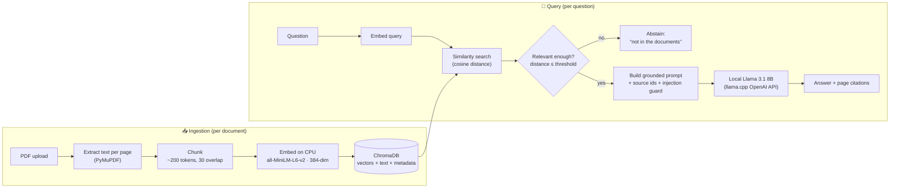

# Local AI Document Assistant

A multi-agent, **fully offline** assistant for your own documents. Ask a question, ask for a
summary, or ask it to pull the images off a page — an intent-routing agent works out what you
want, retrieves the evidence, and answers **grounded in the document text with page citations**,
or tells you plainly that the documents don't say. Nothing is sent to a cloud API; documents
never leave the machine.

Under the hood it's a lean **multi-agent loop** over a local RAG stack: **triage → retrieve
(hybrid) → reason / summarize / extract → act or abstain**. It's end-to-end self-contained — its
own LLM serving ([`serving/`](serving/), llama.cpp running Llama 3.1 8B, or point it at Ollama),
a persistent vector DB (ChromaDB), a web chat UI, and a **measured eval suite** (retrieval modes,
and quantization vs RAG answer quality).

> **Why this matters:** teams with confidential documents (legal, HR, finance)
> often *can't* use cloud LLMs for compliance reasons. This runs entirely on hardware
> they already own, cites the source page for every answer, and **refuses to answer**
> when the documents don't actually support it.

---

## Architecture

Two separate flows — **ingestion** (done once per document) and **query** (every question):



The **embedding model** (retrieval) and the **LLM** (answering) are deliberately
**separate components**: embeddings turn text into vectors for search; the LLM writes
the answer using only the retrieved passages. Each stage (`chunker`, `embedding`,
`vector_store`, `retriever`, `prompt_builder`, `llm_client`) is an isolated, independently
tested service.

---

## How it works (functionality)

1. **Upload** a PDF → stored under a generated `doc_id`.
2. **Index** it → text is extracted page-by-page, split into overlapping chunks, embedded
   locally, and persisted in ChromaDB (survives restarts; re-indexing never duplicates).
3. **Ask** a question → it's embedded and matched against the stored chunks by cosine distance.
4. **Relevance gate** → if no chunk is close enough, the app **abstains without calling the LLM**.
5. **Grounded answer** → the top passages + question are sent to the local Llama with strict
   rules (use only this evidence, cite sources, don't invent), and the answer comes back with
   **page citations**. Fabricated citations are stripped out.

## The agent layer

On top of the RAG core is a **lean multi-agent loop** (`app/agents/`). A **triage** agent reads your
request — a question, a summary, or "extract the images on page 3" — rewrites follow-ups into
standalone queries (**multi-turn memory**), and routes to the right specialist:

- **retrieve** — dense, BM25, or **hybrid** (Reciprocal Rank Fusion) retrieval, switchable per request
- **reason / summarize** — a grounded, page-cited answer
- **extract_images** — render a page and read it with a local vision model (VLM)
- **abstain** — when the evidence is weak, say so instead of guessing

Every turn returns a **step trace** so you can see what the agent did, and document text is always
treated as untrusted (prompt-injection defense).

**Two UIs:** a web chat UI at **`/ui`** (served by the API — mode toggle, citations, agent-step panel),
and the original Streamlit app (`frontend/streamlit_app.py`) with its evaluation dashboard.

## Screenshots

> Captured from the Streamlit UI (`docs/images/`).

| Chat | Evaluation | About |
| ---- | ---------- | ----- |
|  |  |  |

---

## API reference

| Method & path | What it does |
| ------------- | ------------ |
| `GET /health` | Liveness + config snapshot |
| `POST /documents/upload` | Accept a PDF (multipart); validate type/size/magic-bytes; store under a `doc_id` |
| `POST /documents/{doc_id}/process` | Extract text **page by page** (PyMuPDF), preserving 1-based page numbers |
| `POST /documents/{doc_id}/index` | Extract → chunk → embed (CPU) → persist to ChromaDB; idempotent |
| `POST /search` | Embed a query; return top-k chunks with `page_number`, `text`, cosine `distance`; optional `doc_id` filter. **No LLM.** |
| `POST /chat` | **Grounded RAG** (single-shot): retrieve → relevance-gate → prompt local Llama → answer with citations, or `insufficient_evidence`. 503 if LLM unreachable (never a cloud fallback). |
| `POST /agent` | **The multi-agent turn**: triage → retrieve (`dense`/`bm25`/`hybrid`) → answer / summarize / extract-images, or abstain. Takes a multi-turn `messages` list + optional `mode`/`doc_id`. Returns the answer, citations, and a step trace. |

Interactive OpenAPI docs at **`/docs`** when the backend is running.

### Relevance threshold
`RELEVANCE_MAX_DISTANCE` (default **0.6**, cosine) gates answering. It's a **starting
default that must be calibrated** per corpus against representative queries — not a
universal constant. Below it → answer; nothing below it → abstain without calling the LLM.

---

## Bundled LLM serving + quantization study

The [`serving/`](serving/) layer makes this project self-contained — it runs the model the
RAG pipeline answers with, and includes a measured quantization study of it.

```bash
./serving/setup.sh      # one-time: download llama.cpp + the Q4_K_M GGUF (git-ignored, ~5 GB)
./serving/serve.sh      # serve Llama 3.1 8B on :8080 (OpenAI-compatible) — what /chat calls
./serving/bench.sh serving/models/Meta-Llama-3.1-8B-Instruct-Q4_K_M.gguf q4_k_m   # benchmark
```

**Quantization benchmark** (Apple M1 Pro, Metal; full writeup in
[`serving/docs/quantization-case-study.md`](serving/docs/quantization-case-study.md)):

| Precision | Size on disk | Prefill (tok/s) | Decode (tok/s) | Perplexity (WikiText-2) |
| --------- | ------------ | --------------- | -------------- | ----------------------- |
| Q4_K_M    | 4.58 GiB     | **204 ± 20**    | **24.4 ± 0.4** | 8.05 ± 0.29 |
| Q8_0      | 7.95 GiB     | 103 ± 20        | 14.9 ± 0.8     | 7.95 ± 0.29 (reference) |

Q4_K_M is ~2× faster and 42% smaller on disk, and its perplexity gap vs the Q8_0 reference is
within measurement noise (8.05 vs 7.95) — near-lossless. That's why it's the default for serving
the RAG pipeline. (Serving runs on CPU/Metal here; a GPU build of llama.cpp works the same way.)

## Evaluations (measured, not vibes)

A reproducible eval suite in [`evals/`](evals/) — a self-authored corpus + a labelled gold set
(answerable questions with the doc/page that answers them, plus unanswerable ones it *should* refuse):

- **Retrieval modes** (recall@k, MRR): on exact-term / identifier queries **BM25 wins** (recall@3 1.00
  vs dense 0.94); across all queries **hybrid** has the best recall@1 and MRR — the robust default.
- **Quantization × RAG quality**: Llama 3.1 8B at **Q4_K_M vs Q8_0 gives identical answer quality** —
  grounded 86%, cited-page 96%, abstain 100% for both — at 42% less disk. Near-lossless at the *answer*
  level, not just perplexity.

Full numbers and how to reproduce them: [`evals/README.md`](evals/README.md). Write-up:
[**How quantization affects local RAG quality**](docs/quant-rag-quality.md).

## Build stages

| Stage | Deliverable                    | Status |
| ----- | ------------------------------ | ------ |
| 1     | Project setup & API skeleton   | ✅ done |
| 2     | PDF ingestion (extract text)   | ✅ done |
| 3     | Embedding & vector storage     | ✅ done |
| 4     | Retrieval pipeline             | ✅ done |
| 5     | LLM integration (RAG)          | ✅ done — verified end-to-end on the local llama.cpp server |
| 6     | Frontend & evaluation          | ✅ done |

> **Honest status:** Stages 1–4 are fully implemented and verified end-to-end with real
> embeddings. The suite passes **70 mocked tests** (RAG + the agent layer), and the real-model integration test
> **passes against the bundled local llama.cpp server** (Llama 3.1 8B Q4_K_M on Apple Metal) —
> uploads a doc, retrieves, and returns a grounded answer with a correct page citation, fully
> offline (`pytest -m integration`, 1 passed). So "fully offline end-to-end" is verified, not pending.

## Setup

```bash
cd local-document-assistant
python3 -m venv .venv
.venv/bin/pip install -r requirements.txt
```

## Run

```bash
# the API also serves the web chat UI at /ui
.venv/bin/uvicorn app.main:app --port 8000
#   web chat UI:  http://localhost:8000/ui
#   OpenAPI docs: http://localhost:8000/docs
```

Point it at a local model (both OpenAI-compatible):

```bash
./serving/serve.sh                                   # llama.cpp (bundled), Q4_K_M on :8080
# …or Ollama:
LLM_BASE_URL=http://localhost:11434/v1 LLM_MODEL=qwen2.5:7b .venv/bin/uvicorn app.main:app --port 8000
```

Open **`/ui`**, drop in a PDF, pick a retrieval mode, and ask. Optional env: `RETRIEVAL_MODE=hybrid`,
`EXTRACTION_MODE=docling` (needs `pip install docling`), `VISION_MODEL=<a VLM in Ollama>` to enable
image extraction. The original Streamlit app still runs via
`.venv/bin/streamlit run frontend/streamlit_app.py`.

## Test

```bash
.venv/bin/python -m pytest -q                 # 70 fast tests (mocked LLM, no GPU)
.venv/bin/python -m pytest -q -m slow         # real CPU embedding tests (downloads model once)
.venv/bin/python -m pytest -q -m integration  # real local Llama (needs serve.sh running) — 1 passed
```

## Project layout

```
app/
  main.py                 # FastAPI app + routers + /health
  config.py               # paths, limits, LLM + embedding + relevance settings
  api/
    upload.py             # /documents/upload, /process, /index
    search.py             # /search (retrieval only)
    chat.py               # /chat (grounded RAG answering, single-shot)
    agent.py              # /agent (multi-agent, multi-turn)
  agents/                 # the lean multi-agent layer:
    triage.py             #   intent routing + follow-up condensing (rule fallback)
    orchestrator.py       #   triage → retrieve → reason/summarize/extract → abstain
  services/               # one isolated, tested service per responsibility:
    pdf_processor.py      #   PyMuPDF text extraction (page provenance)
    extraction.py         #   pluggable: basic | docling (layout+tables+OCR), graceful fallback
    chunker.py            #   token-aware chunking (no ML imports)
    embedding.py          #   all-MiniLM-L6-v2, lazy-loaded, CPU
    vector_store.py       #   ChromaDB persistence + query
    retriever.py          #   dense retrieval → ranked chunks
    hybrid.py             #   dense + BM25 + RRF (switchable mode)
    prompt_builder.py     #   grounded prompt + citation validation
    llm_client.py         #   local OpenAI-compatible client (no cloud fallback)
    vision.py             #   image/figure extraction via a local VLM
web/                      # the web chat UI (served at /ui)
evals/                    # corpus + gold set + harnesses (retrieval modes, quant × RAG)
frontend/streamlit_app.py # the original Streamlit UI (chat, passages, eval dashboard)
.streamlit/config.toml    # dark theme
serving/                  # bundled local LLM serving + quantization study
  setup.sh                #   download llama.cpp + GGUF model (git-ignored)
  serve.sh                #   serve Llama 3.1 8B on :8080 (OpenAI-compatible)
  bench.sh                #   throughput benchmark harness
  bin/                    #   llama.cpp tool wrappers
  results/                #   benchmark CSV/MD
  docs/quantization-case-study.md
data/uploads/             # stored PDFs (git-ignored)
data/chroma_db/           # vector store (git-ignored)
tests/                    # pytest (unit + integration, temp-isolated)
```

## Known limitations
- **Docling & image extraction are optional** — coded and unit-tested with graceful fallback, but not
  enabled by default. Turn them on with `pip install docling` and a `VISION_MODEL` (a VLM in Ollama);
  without docling, scanned/image-only PDFs yield no text (handled gracefully, not crashed).
- **No original filename** in metadata yet — citations carry `doc_id` + page, not the upload name.
- **Relevance threshold is heuristic** — 0.6 works for the sample corpus but needs real calibration.
- **Evals are small and self-authored** — a few dozen questions on a fictional corpus; directional, not
  a benchmark. The quant × RAG latency numbers are confounded by a 16 GB Mac swapping on the 8 GB Q8 model.

## License notes
Uses Llama 3.1 under the [Llama 3.1 Community License](https://www.llama.com/llama3_1/license/);
embeddings via `all-MiniLM-L6-v2` (Apache-2.0); ChromaDB (Apache-2.0); llama.cpp (MIT).
