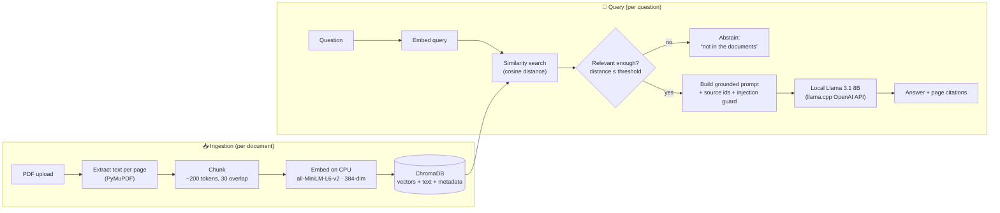

# Local AI Document Assistant

Ask questions about your own documents — contracts, reports, policies — and get
answers **grounded in the document text**, generated by a **local LLM**. Nothing
is sent to a cloud API; documents never leave the machine.

This is a **RAG** (Retrieval-Augmented Generation) application, and it's **end-to-end
self-contained**: it ships its own **local LLM serving layer** ([`serving/`](serving/)) —
llama.cpp running Llama 3.1 8B behind an OpenAI-compatible API — plus a **quantization
benchmark** of that model. Nothing depends on a separate project or a cloud service.

> **Why this matters:** teams with confidential documents (legal, HR, finance)
> often *can't* use cloud LLMs for compliance reasons. This runs entirely on hardware
> they already own, cites the source page for every answer, and **refuses to answer**
> when the documents don't actually support it.

---

## Architecture

Two separate flows — **ingestion** (done once per document) and **query** (every question):



The **embedding model** (retrieval) and the **LLM** (answering) are deliberately
**separate components**: embeddings turn text into vectors for search; the LLM writes
the answer using only the retrieved passages. Each stage (`chunker`, `embedding`,
`vector_store`, `retriever`, `prompt_builder`, `llm_client`) is an isolated, independently
tested service.

---

## How it works (functionality)

1. **Upload** a PDF → stored under a generated `doc_id`.
2. **Index** it → text is extracted page-by-page, split into overlapping chunks, embedded
   locally, and persisted in ChromaDB (survives restarts; re-indexing never duplicates).
3. **Ask** a question → it's embedded and matched against the stored chunks by cosine distance.
4. **Relevance gate** → if no chunk is close enough, the app **abstains without calling the LLM**.
5. **Grounded answer** → the top passages + question are sent to the local Llama with strict
   rules (use only this evidence, cite sources, don't invent), and the answer comes back with
   **page citations**. Fabricated citations are stripped out.

A **Streamlit UI** wraps all of this: upload/sample loading, a chat with cited answers, a
retrieved-passage viewer, and a small **evaluation dashboard** that scores a gold-set of
questions (including one that *should* be abstained).

## Screenshots

> Captured from the Streamlit UI (`docs/images/`).

| Chat | Evaluation | About |
| ---- | ---------- | ----- |
|  |  |  |

---

## API reference

| Method & path | What it does |
| ------------- | ------------ |
| `GET /health` | Liveness + config snapshot |
| `POST /documents/upload` | Accept a PDF (multipart); validate type/size/magic-bytes; store under a `doc_id` |
| `POST /documents/{doc_id}/process` | Extract text **page by page** (PyMuPDF), preserving 1-based page numbers |
| `POST /documents/{doc_id}/index` | Extract → chunk → embed (CPU) → persist to ChromaDB; idempotent |
| `POST /search` | Embed a query; return top-k chunks with `page_number`, `text`, cosine `distance`; optional `doc_id` filter. **No LLM.** |
| `POST /chat` | **Grounded RAG**: retrieve → relevance-gate → prompt local Llama → answer with citations, or `insufficient_evidence`. 503 if LLM unreachable (never a cloud fallback). |

Interactive OpenAPI docs at **`/docs`** when the backend is running.

### Relevance threshold
`RELEVANCE_MAX_DISTANCE` (default **0.6**, cosine) gates answering. It's a **starting
default that must be calibrated** per corpus against representative queries — not a
universal constant. Below it → answer; nothing below it → abstain without calling the LLM.

---

## Bundled LLM serving + quantization study

The [`serving/`](serving/) layer makes this project self-contained — it runs the model the
RAG pipeline answers with, and includes a measured quantization study of it.

```bash
./serving/setup.sh      # one-time: download llama.cpp + the Q4_K_M GGUF (git-ignored, ~5 GB)
./serving/serve.sh      # serve Llama 3.1 8B on :8080 (OpenAI-compatible) — what /chat calls
./serving/bench.sh serving/models/Meta-Llama-3.1-8B-Instruct-Q4_K_M.gguf q4_k_m   # benchmark
```

**Quantization benchmark** (Apple M1 Pro, Metal; full writeup in
[`serving/docs/quantization-case-study.md`](serving/docs/quantization-case-study.md)):

| Precision | Size on disk | Prefill (tok/s) | Decode (tok/s) | Role |
| --------- | ------------ | --------------- | -------------- | ---- |
| Q4_K_M    | 4.58 GiB     | **204 ± 20**    | **24.4 ± 0.4** | daily driver |
| Q8_0      | 7.95 GiB     | 103 ± 20        | 14.9 ± 0.8     | quality reference |

Q4_K_M is ~2× faster and 42% smaller on disk — the reason it's the default for serving the
RAG pipeline. (Serving runs on CPU/Metal here; a GPU build of llama.cpp works the same way.)

## Build stages

| Stage | Deliverable                    | Status |
| ----- | ------------------------------ | ------ |
| 1     | Project setup & API skeleton   | ✅ done |
| 2     | PDF ingestion (extract text)   | ✅ done |
| 3     | Embedding & vector storage     | ✅ done |
| 4     | Retrieval pipeline             | ✅ done |
| 5     | LLM integration (RAG)          | ✅ done (mock-tested; **live LLM generation pending**) |
| 6     | Frontend & evaluation          | ✅ done |

> **Honest status:** Stages 1–4 are fully implemented and verified end-to-end with real
> embeddings. Stage 5 passes **56 mocked tests**; the real local-model integration test is
> wired but not yet run, so "fully offline end-to-end" is pending that run.

## Setup

```bash
cd local-document-assistant
python3 -m venv .venv
.venv/bin/pip install -r requirements.txt
```

## Run

```bash
# terminal 1 — backend API
.venv/bin/uvicorn app.main:app --reload --port 8000     # docs at http://localhost:8000/docs

# terminal 2 — Streamlit UI
.venv/bin/streamlit run frontend/streamlit_app.py        # opens http://localhost:8501
```

The UI runs in **Demo mode** by default (answers from retrieved passages, **no GPU**).
Turn off "Demo mode" in the sidebar to use the real local Llama — start the bundled server
first: `./serving/serve.sh` (serves on :8080, which `app/config.py` already targets). Click
**Load sample** to index a demo contract instantly, or upload your own PDF.

## Test

```bash
.venv/bin/python -m pytest -q                 # 56 fast tests (mocked LLM, no GPU)
.venv/bin/python -m pytest -q -m slow         # real CPU embedding tests (downloads model once)
.venv/bin/python -m pytest -q -m integration  # real local Llama (needs serve.sh running)
```

## Project layout

```
app/
  main.py                 # FastAPI app + routers + /health
  config.py               # paths, limits, LLM + embedding + relevance settings
  api/
    upload.py             # /documents/upload, /process, /index
    search.py             # /search (retrieval only)
    chat.py               # /chat (grounded RAG answering)
  services/               # one isolated, tested service per responsibility:
    pdf_processor.py      #   PDF text extraction (page provenance)
    chunker.py            #   token-aware chunking (no ML imports)
    embedding.py          #   all-MiniLM-L6-v2, lazy-loaded, CPU
    vector_store.py       #   ChromaDB persistence + query
    retriever.py          #   query → ranked chunks
    prompt_builder.py     #   grounded prompt + citation validation
    llm_client.py         #   local OpenAI-compatible client (no cloud fallback)
frontend/streamlit_app.py # the UI (chat, passages, evaluation dashboard)
.streamlit/config.toml    # dark theme
serving/                  # bundled local LLM serving + quantization study
  setup.sh                #   download llama.cpp + GGUF model (git-ignored)
  serve.sh                #   serve Llama 3.1 8B on :8080 (OpenAI-compatible)
  bench.sh                #   throughput benchmark harness
  bin/                    #   llama.cpp tool wrappers
  results/                #   benchmark CSV/MD
  docs/quantization-case-study.md
data/uploads/             # stored PDFs (git-ignored)
data/chroma_db/           # vector store (git-ignored)
tests/                    # pytest (unit + integration, temp-isolated)
```

## Known limitations
- **Live LLM generation not yet verified** (Stage 5 is mock-tested) — see status note above.
- **No OCR** — scanned/image-only PDFs yield no text (handled gracefully, not crashed).
- **No original filename** in metadata yet — citations carry `doc_id` + page, not the upload name.
- **Relevance threshold is heuristic** — 0.6 works for the sample corpus but needs real calibration.
- **Single-shot** — no multi-turn memory, re-ranking, or hybrid keyword+vector search (out of scope).

## License notes
Uses Llama 3.1 under the [Llama 3.1 Community License](https://www.llama.com/llama3_1/license/);
embeddings via `all-MiniLM-L6-v2` (Apache-2.0); ChromaDB (Apache-2.0); llama.cpp (MIT).
